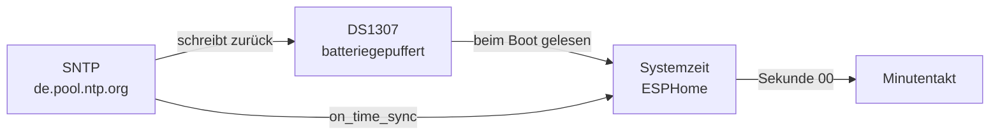
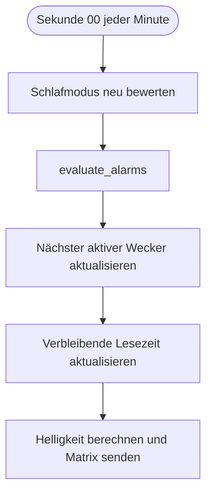
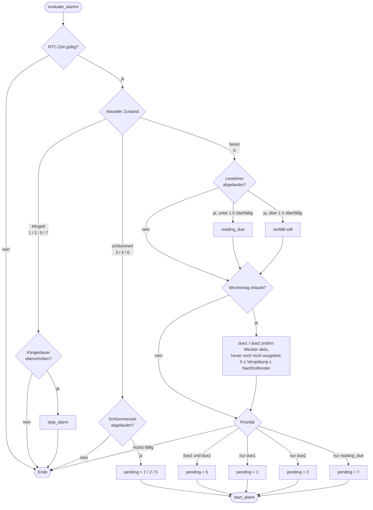
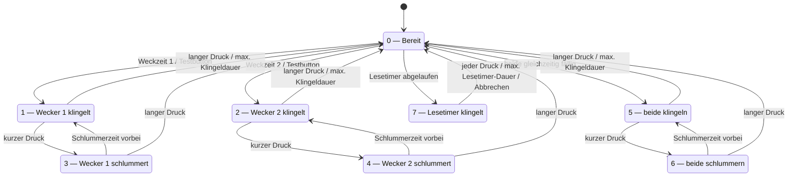
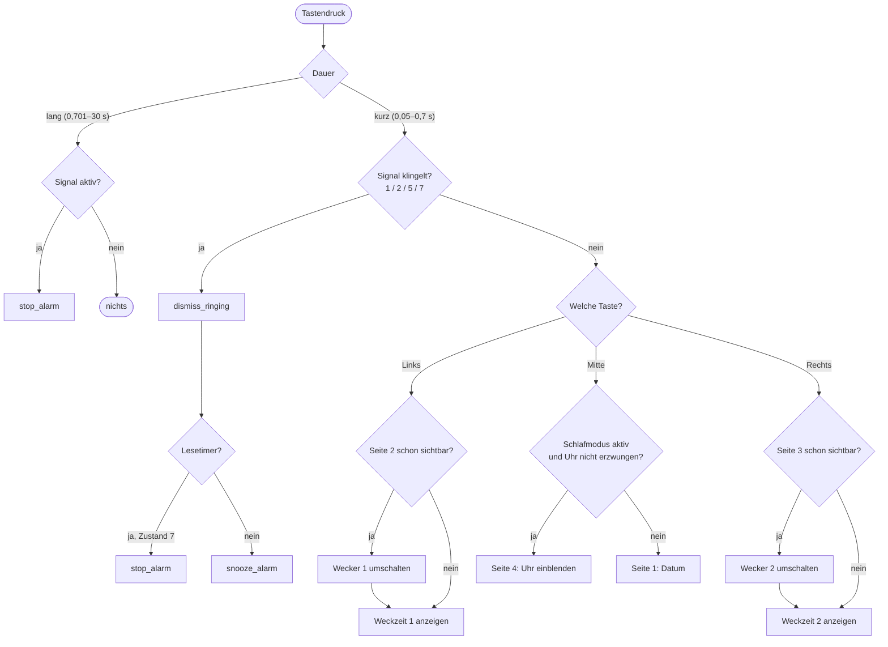
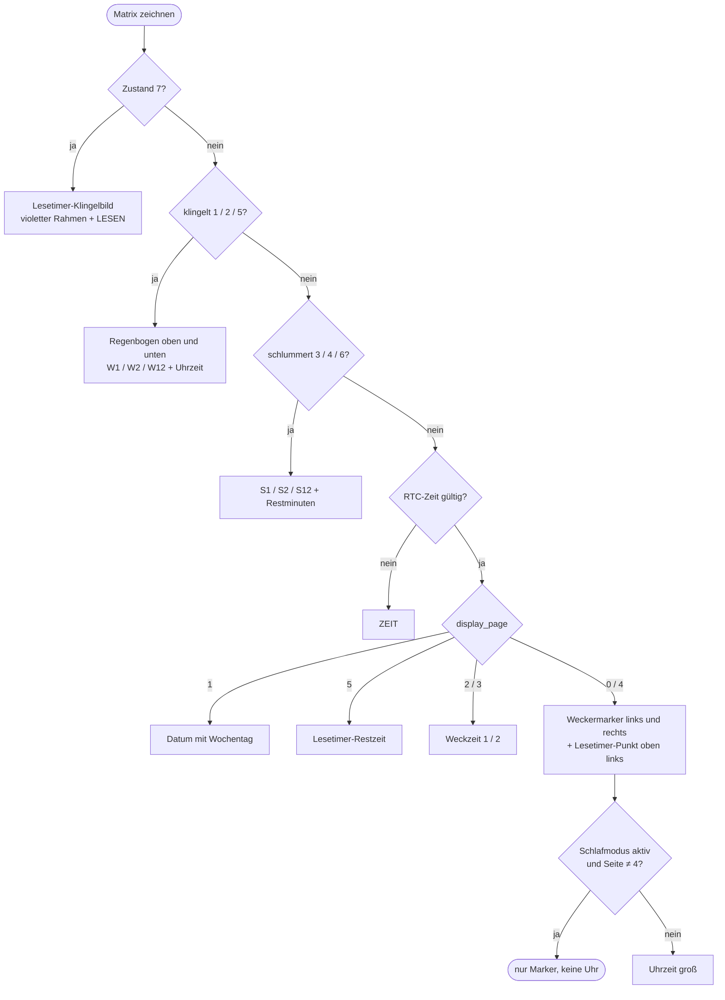
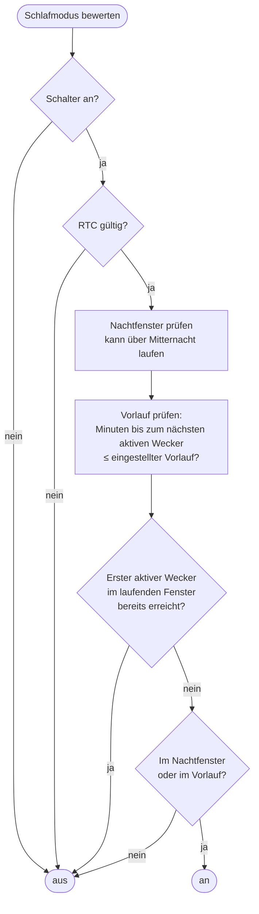
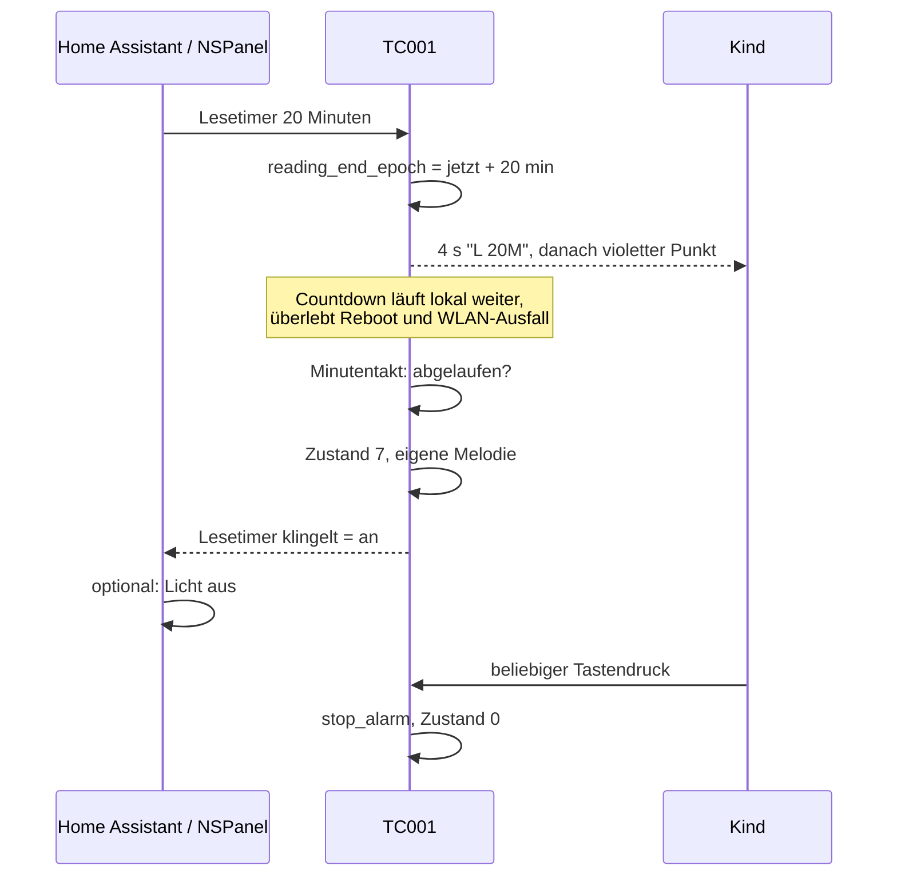
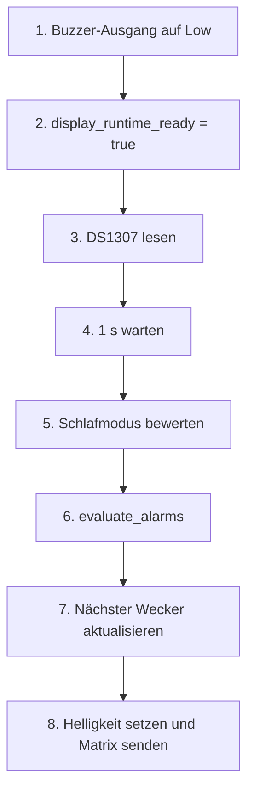

# Architektur und Abläufe

Stand der Software, wie sie aktuell im Repository liegt. Dieses Dokument
beschreibt das Zusammenspiel der Pakete; die Bedienung aus Nutzersicht steht in
der [README](../README.md), die Abnahmekriterien in [testplan.md](testplan.md).

## Leitprinzip

Der Alarm läuft vollständig auf dem Gerät. Home Assistant stellt ein, zeigt an
und ergänzt optionale Aktionen wie Licht — ist zum Weckzeitpunkt aber nicht
erforderlich. Jede Entscheidung darüber, *ob* geklingelt wird, fällt in einem
Lambda auf dem ESP32; jede Zeitquelle, auf die sich diese Entscheidung stützt,
funktioniert ohne Netzwerk.

Daraus folgen drei Regeln, die den ganzen Aufbau erklären:

1. **Zeit kommt aus dem DS1307**, nicht aus dem Netz. SNTP korrigiert nur.
2. **Zustand überlebt Neustarts.** Ein klingelnder oder schlummernder Alarm
   wird nach einem Reboot fortgesetzt, kein Weckruf geht verloren.
3. **Das Display ist teuer.** Es wird einmal pro Minute übertragen — nur bei
   Tastendruck, Zustandswechsel oder laufendem Alarm häufiger.

## Paketstruktur

Es gibt zwei Geräte: **Wecker 1** und **Wecker 2**. Jedes hat eine eigene,
rund zwanzig Zeilen kurze Datei — `esphome/wecker-1.yaml` und
`esphome/wecker-2.yaml` — die nur Substitutions (Name, IP, Zeitzone) und die
gerätespezifischen API- und OTA-Secrets enthält. Alles Gemeinsame liegt in
`packages/base.yaml`, die fachliche Logik in den übrigen Paketen.

Die Secrets bleiben bewusst in den Gerätedateien statt in Substitutions: nur so
maskiert `esphome config` sie weiterhin als `!secret`, statt sie im Klartext
auszugeben.

| Paket | Verantwortung |
|---|---|
| `base.yaml` | Gerät, WLAN, Webserver, Logger, Boot-Sequenz; bindet alle folgenden Pakete ein |
| `hardware.yaml` | I²C, Buzzer-Ausgang, RTTTL, LED-Matrix, ADC-Sensoren (LDR, Akku), Akkuprozent, SHT3x, Akkuwarnton |
| `time.yaml` | DS1307 als Taktgeber, SNTP-Korrektur, Minutentakt, `Zeit gültig` |
| `alarms.yaml` | Weckzeiten, Zustandsmaschine `alarm_state`, alle Alarm-Skripte, Testbuttons |
| `reading-timer.yaml` | Lesetimer: Countdown, Presets, eigener Klingelton |
| `sleep.yaml` | Nachtfenster, Vorlauf, `Schlafmodus aktiv` |
| `display.yaml` | Fonts, Helligkeitsregelung, Seitenlogik, Matrix-Lambda, Klingelanimation |
| `controls.yaml` | Die drei Gerätetasten |
| `diagnostics.yaml` | Alarmstatus, nächster Wecker, WLAN/Laufzeit, Neustart |

Pakete werden von ESPHome zu **einer** Konfiguration verschmolzen. IDs sind
deshalb global: `display.yaml` darf `alarm_state` aus `alarms.yaml` lesen, und
`alarms.yaml` ruft `show_temporary_page` aus `display.yaml` auf. Die Trennung
ist Ordnung, keine Kapselung.

## Zeitquellen

Der DS1307 läuft mit `update_interval: never` — er wird einmal beim Boot
gelesen und danach nur noch von SNTP zurückgeschrieben. Der Minutentakt hängt
an der Systemzeit, nicht am RTC-Leseintervall, und driftet daher nicht mit der
Bootzeit.

Synchronisiert SNTP mitten in einem Nachholfenster, wird `evaluate_alarms`
sofort erneut ausgeführt, statt auf die nächste volle Minute zu warten.

## Der Minutentakt

Das Herz der Firmware. Alles Regelmäßige hängt hier dran, ausgerichtet auf
Sekunde 00 der Wanduhr.

## evaluate_alarms

Die zentrale Entscheidung. Das Lambda setzt nur `pending_alarm_id` und
`alarm_stop_required`; ausgeführt wird danach in YAML-Actions.

Drei Details, die leicht übersehen werden:

- **Der Weckalarm gewinnt.** Fallen Lesetimer und echter Wecker in dieselbe
  Minute, gewinnt der Wecker; der Lesetimer verfällt dabei.
- **Der Lesetimer wird vor dem Wochentag-Guard geprüft**, denn er soll auch
  samstags laufen, während „Nur Montag bis Freitag" aktiv ist.
- **`last_fired_alarm_N_key`** verhindert doppeltes Auslösen. Der Schlüssel ist
  `(Jahr * 1000 + Tag im Jahr) * 10000 + Weckminute`, wird beim Fälligwerden
  gesetzt und überlebt den Neustart — deshalb löst ein Reboot im Nachholfenster
  genau einmal aus. Dass die **Weckzeit Teil des Schlüssels** ist, ist wichtig:
  ein Schlüssel nur aus dem Tag würde einen Wecker für den Rest des Tages
  blockieren, sobald er einmal geklingelt hat. Eine neue Weckzeit ist aber eine
  neue Absicht und muss am selben Tag erneut klingeln dürfen.

## Zustandsmaschine `alarm_state`

Ein einziges persistentes `int`-Global trägt den gesamten Signalzustand.

Zustand 7 hat bewusst **keinen** Schlummerzustand: Lesezeit verlängern bleibt
eine Entscheidung der Eltern in Home Assistant, nicht des Kindes am Gerät.

`ring_started_epoch` und `snooze_until_epoch` tragen die zugehörigen
Zeitstempel. Beide sind persistent, damit ein Reboot während Klingeln oder
Snooze korrekt fortsetzt statt von vorn zu beginnen.

## Tastenlogik

Alle drei Tasten teilen dieselbe Struktur: kurzer Druck 50–700 ms, langer Druck
701 ms–30 s, beide mit 20 ms Entprellung. Damit gibt es zwischen kurzem und
langem Druck keinen unbelegten Zeitbereich.

Jede eingeblendete Seite fällt nach vier Sekunden auf die Standardanzeige
zurück. Das Umschalten eines Weckers verlangt deshalb zwei Drücke innerhalb
dieser vier Sekunden — Absicht, damit bloßes Nachsehen nichts verstellt.

## Displayseiten

`display_page` wählt nur zwischen den *temporären* Seiten; Alarmzustände haben
immer Vorrang. Die Reihenfolge im Matrix-Lambda ist:

| Seite | Inhalt | Ausgelöst durch |
|---|---|---|
| 0 | Uhr mit Weckermarkern | Standard |
| 1 | Datum | Mitte, kurz |
| 2 | Weckzeit 1 | Links, kurz |
| 3 | Weckzeit 2 | Rechts, kurz |
| 4 | Uhr erzwungen | Mitte, kurz, im Schlafmodus |
| 5 | Lesetimer-Restzeit | Start eines Lesetimers |

## Refresh-Strategie

Die Matrix ist der größte Verbraucher und wird bewusst selten übertragen.

| Anlass | Frequenz |
|---|---|
| Regulärer Betrieb | einmal pro Minute, Sekunde 00 |
| Tastendruck, Wecker-, Zeit-, Schlafmodus- oder Helligkeitsänderung | sofort |
| Wechsel des Alarmzustands | sofort |
| Laufender Weckalarm | ca. 8 Bilder pro Sekunde (Regenbogenanimation) |
| Watchdog | alle 24 h |

Die Animationsschleife prüft in ihrer eigenen `while`-Bedingung, ob noch ein
Weckalarm klingelt, und endet von selbst. Im Leerlauf kostet sie nichts.

Die automatische Helligkeitsmessung (LDR, alle 10 s, Median über 7 Werte)
berechnet nur den Skalierungsfaktor neu; sichtbar wird sie mit dem nächsten
Minutenbild.

## Schlafmodus

Der Vorlauf sucht bis zu acht Tage voraus und berücksichtigt dabei „Nur Montag
bis Freitag" — so beginnt der Schlafmodus am Sonntagabend korrekt vor dem
Montagswecker. `wakeup_reached` sorgt dafür, dass der Schlafmodus nach der
ersten Weckzeit bis zum nächsten Abend aus bleibt, auch wenn später am Tag noch
ein zweiter Wecker aktiv ist.

## Lesetimer

Der Lesetimer kennt eine eigene, kürzere maximale Klingeldauer (Standard zwei
Minuten), weil er zur Schlafenszeit auslöst — ein langes Klingeln wäre dort
schlimmer als ein verpasstes.

`Klingelt` und `Lesetimer klingelt` sind getrennte Entitäten, damit Home
Assistant morgens das Licht ein- und abends ausschalten kann.

## Bootsequenz

Die Reihenfolge in `on_boot` (Priorität −100) ist nicht beliebig:

- **Schritt 1** zuerst, weil GPIO15 sonst beim Start pfeift.
- **Schritt 2** gibt die Matrix frei. Wiederhergestellte Template-Entitäten
  veröffentlichen ihre Werte, während Komponenten noch aufgebaut werden; ohne
  dieses Flag würden sie die Matrix anfassen, bevor deren LightState existiert.
- **Schritt 3 vor 6**, damit `evaluate_alarms` eine gültige Zeit sieht und ein
  wiederhergestellter Alarm korrekt fortgesetzt wird.

## Persistenz

`preferences: flash_write_interval: 1s`. Über einen Neustart hinweg erhalten
bleiben:

| Was | Wo |
|---|---|
| Alarmzustand, Klingelbeginn, Schlummerende | Globals `alarm_state`, `ring_started_epoch`, `snooze_until_epoch` |
| „diese Weckzeit heute schon ausgelöst" | `last_fired_alarm_1_key`, `last_fired_alarm_2_key` |
| Lesetimer-Ende | `reading_end_epoch` |
| Weckzeiten, Schlafmodus-Zeiten | `datetime`-Entitäten mit `restore_value` |
| Alle Zahlen und Klingeltöne | `number`- und `text`-Entitäten mit `restore_value` |
| Schalterzustände | `restore_mode: RESTORE_DEFAULT_ON/OFF` |

Nicht persistent und bewusst so: `display_page`, `display_color_scale`,
`alarm_animation_frame`, `pending_alarm_id`, `alarm_stop_required`.

## Entitäten in Home Assistant

| Gruppe | Entitäten |
|---|---|
| Weckzeiten | Weckzeit 1. Stunde, Weckzeit 2. Stunde |
| Wecker | Wecker 1. Stunde, Wecker 2. Stunde, Nur Montag bis Freitag |
| Klingeltöne | Klingelton 1. Stunde, Klingelton 2. Stunde, Klingelton Lesetimer (alle RTTTL) |
| Zeiten | Schlummerdauer, Maximale Klingeldauer, Nachholfenster |
| Schlafmodus | Schlafmodus, Schlafmodus ab/bis, Schlafmodus vor Wecker, Schlafmodus aktiv |
| Lesetimer | Lesezeit, Maximale Lesetimer-Klingeldauer, Verbleibende Lesezeit, Lesetimer läuft, Lesetimer klingelt, fünf Buttons |
| Anzeige | Displayhelligkeit Tag, Displayhelligkeit Dunkel, Automatische Helligkeit |
| Status | Alarmstatus, Nächster aktiver Wecker, Klingelt, Schlummert, Zeit gültig |
| Messwerte | Batteriestand, Batteriespannung, Batterie schwach, Temperatur, Luftfeuchtigkeit |
| Diagnose | WLAN-Signal, Laufzeit, IP-Adresse, Neustart |
| Test | Wecker 1 testen, Wecker 2 testen, Alarm schlummern, Alarm beenden |

## Bewusste Nicht-Entscheidungen

- **Kein Deep Sleep, kein Auto Light Sleep.** ESPHome unterstützt Auto Light
  Sleep nicht (kein `esp_pm_configure`-Aufruf). Deep Sleep wäre baubar, spart
  aber nur den ESP32-Anteil: die 256 WS2812 ziehen rund 150 mA Ruhestrom, auch
  wenn sie schwarz sind, und lassen sich mangels Schalttransistor nicht
  abschalten. Uhr, Tasten, API und Webinterface bleiben dafür durchgehend
  erreichbar.
- **Keine Wochenpläne.** Beide Wecker wiederholen sich an erlaubten Wochentagen;
  eingestellt wird in Home Assistant, am Gerät nur angezeigt und geschaltet.
- **Akkuprozent ist eine Schätzung** aus der Zellspannung, kein Coulomb-Counter.
  Die rohe Spannung bleibt zur Kalibrierung sichtbar.
